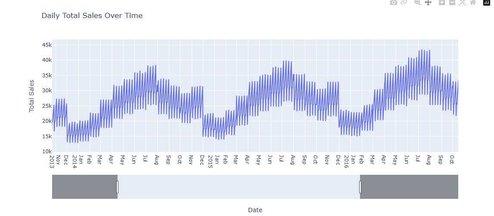
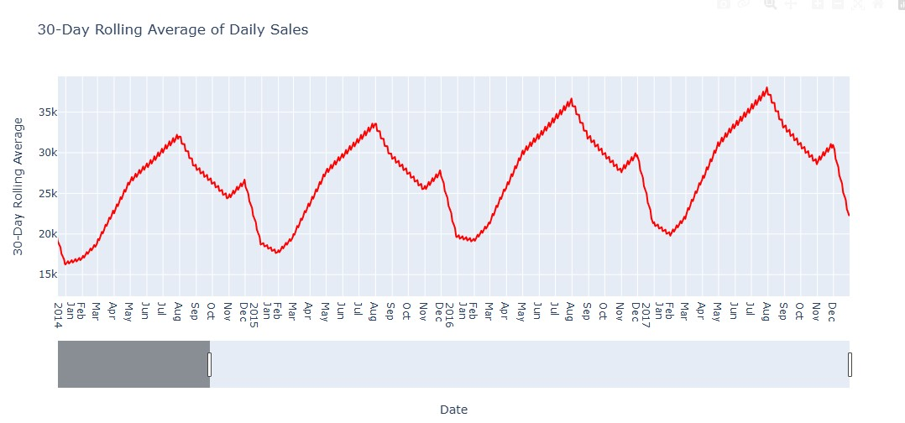
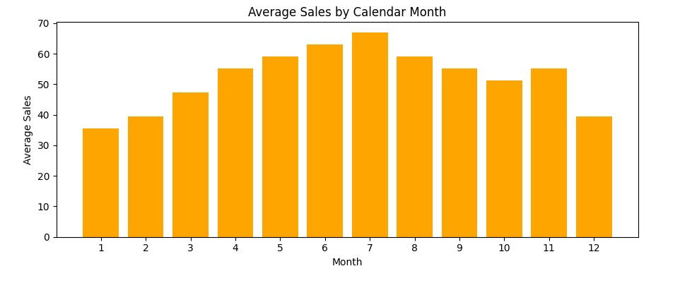
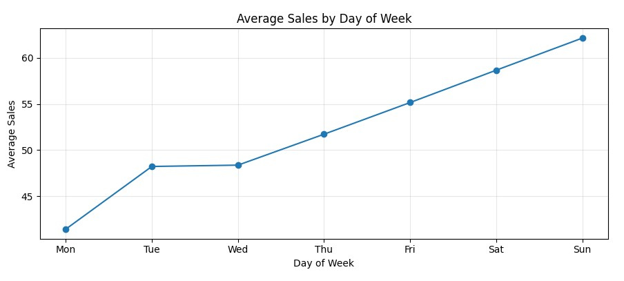
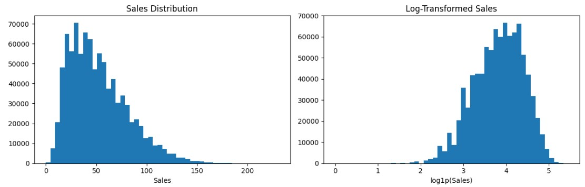

# 📈 Store Item Demand Forecasting

End-to-end retail demand forecasting project: explore 5 years of store-item sales, engineer time-series features, train and tune an **XGBoost** model, evaluate it with **sMAPE**, and serve it through an interactive **Streamlit** app.


---

## 🎯 Problem Statement

Predict daily unit sales for **50 items across 10 stores** for the next 3 months (Jan 1 – Mar 31, 2018), using only historical sales from 2013–2017. Better demand forecasts help retailers plan inventory, avoid stockouts and reduce overstocking.

---

## 📊 Dataset at a Glance

| Item | Value |
|---|---|
| Training rows | **913,000** |
| Test rows (forecast horizon) | **45,000** |
| Stores | **10** |
| Items | **50** |
| Training period | 2013-01-01 → 2017-12-31 (5 years, daily) |
| Forecast period | 2018-01-01 → 2018-03-31 (90 days) |
| Missing values | 0 |
| Avg. daily sales per store-item | 52.25 (std 28.80) |
| Sales range | 0 → 231 |
| Median / 75th percentile | 47 / 70 |

Columns: `date`, `store`, `item`, `sales`.

### 📥 Data Source

The data comes from the Kaggle **Store Item Demand Forecasting Challenge**:

- Competition: [kaggle.com/c/demand-forecasting-kernels-only](https://www.kaggle.com/c/demand-forecasting-kernels-only)
- Download the data: [kaggle.com/c/demand-forecasting-kernels-only/data](https://www.kaggle.com/c/demand-forecasting-kernels-only/data)

The CSV files are not included in this repo. Download `train.csv`, `test.csv` and `sample_submission.csv` and place them in the project root before running the notebook. (The Streamlit app only needs `train.csv` and `test.csv`, uploaded from the sidebar.)

---

## 🔍 Exploratory Data Analysis

### Daily total sales
Strong yearly seasonality with a steady upward trend across the years.



### 30-day rolling average
The rolling average makes the pattern clear: sales climb every spring, **peak around July/August**, and fall to a low around **January**. The yearly peak rises from ~32k (2014) to ~38k (2017) total daily units.



### Monthly seasonality
Average sales per store-item peak in **July (~67)** and are lowest in **January (~35)** and **December (~39)**, almost a 2x swing.



### Weekday pattern
Sales rise steadily through the week: **Monday is lowest (~41)** and **Sunday is highest (~62)**, roughly 50% higher.



### Sales distribution
Raw sales are right-skewed; applying `log1p` gives a near-normal shape, so the model is trained on `log1p(sales)` and predictions are converted back with `expm1`.



---

## 🛠️ Methodology

1. **Validation of data**: schema checks, missing values, date ranges.
2. **Feature engineering** (13 features)
   - Calendar: `day`, `month`, `year`, `dayofweek`, `dayofyear`, `weekofyear`
   - Store-item statistics: `sales_mean`, `sales_median`, `sales_std`
   - Lag features: `lag_7`, `lag_14`, `lag_28`, `lag_365`
3. **Chronological validation**: last 90 days of training data held out (2017-10-02 onward). Train: **864,000 rows**, validation: **45,500 rows**.
4. **Metric**: sMAPE (Symmetric Mean Absolute Percentage Error), lower is better.
5. **Baselines** vs. XGBoost on the same validation rows.
6. **Hyperparameter tuning**: 20 randomized XGBoost configurations.
7. **Final model**: retrained on all **909,500** rows with lag history.
8. **Recursive forecasting**: test dates are predicted one day at a time and each day's predictions feed the lag features of later days.

---

## 🏆 Results

### Model comparison (validation sMAPE, last 90 days)

| Model | sMAPE (%) |
|---|---|
| **Tuned XGBoost** | **12.37** |
| XGBoost (default config) | 12.49 |
| Lasso | 15.80 |
| Ridge | 16.03 |
| Linear Regression | 16.03 |
| Global mean baseline | 44.18 |

- Tuned XGBoost cuts error by **~72%** vs. the global-mean baseline (44.18 → 12.37).
- It is **~22%** better than the best linear model (15.80 → 12.37).

### Best hyperparameters (from 20 trials)

```python
{
  "objective": "reg:squarederror",
  "eta": 0.05,
  "max_depth": 8,
  "subsample": 0.8,
  "colsample_bytree": 0.6,
  "min_child_weight": 7,
  "lambda": 0,
  "alpha": 0.1,
  "num_boost_round": 500
}
```

Across the 20 trials, sMAPE ranged from **12.37% to 13.72%**, so the model is stable under tuning.

> ⚠️ **Note on validation:** lag features in the validation window can use earlier actual values, so 12.37% is an initial diagnostic, not a perfect multi-step backtest. The real 90-day recursive forecast error is likely somewhat higher.

---

## 🖥️ Streamlit App

`app.py` is an interactive dashboard that automatically loads `train.csv` and `test.csv` statically, allowing you to tune hyperparameters and generate predictions with one click.

**Features**
- **Static Dataset Loading**: Automatically loads `train.csv` and `test.csv` (no file upload required by the user)
- Controls: boosting rounds (100–700), learning rate (0.02–0.1), tree depth (3–10)
- Metrics: validation sMAPE, mean-baseline sMAPE, improvement vs. baseline
- Charts: predicted daily total sales, demand by store, demand by item
- Filterable predictions table with **CSV download**
- XGBoost feature-importance (gain) chart

**Run it**

```bash
pip install -r requirements.txt
streamlit run app.py
```

---

## 📁 Project Structure

```
├── app.py                          # Streamlit forecasting app
├── DemandForecast_organized.ipynb  # EDA, modeling, tuning, submission
├── tuned_xgboost_model.json        # Saved final XGBoost model
├── submission.csv                  # 45,000 predictions for 2018-01-01 → 2018-03-31
├── images/                         # Charts used in this README
├── requirements.txt
└── README.md
```

## ⚙️ Setup

```bash
git clone https://github.com/<your-username>/<your-repo>.git
cd <your-repo>
pip install pandas numpy scikit-learn xgboost plotly matplotlib streamlit
```

Place `train.csv`, `test.csv` and `sample_submission.csv` in the project folder, then run the notebook top to bottom.

---

## ✅ Conclusion

- Built a complete pipeline on **913,000 sales records** (10 stores × 50 items × 5 years) that produces **45,000 daily forecasts** for a 90-day horizon.
- Found clear, actionable patterns: **July peak vs. January low (~2x)** and **Sunday vs. Monday (~50% higher)**.
- **Tuned XGBoost achieved 12.37% sMAPE**, compared with 44.18% for a naive mean baseline and 15.80% for the best linear model.
- Delivered both a reproducible notebook and a **deployable Streamlit app** so non-technical users can run forecasts and export results.

**Business value:** store-item level forecasts support inventory replenishment, purchase planning and staffing around weekly and seasonal peaks. Actual cost savings would need to be measured in a real deployment.

### 🔮 Future Work
- Proper multi-step (recursive) backtesting for a more realistic error estimate
- Holiday, promotion and price features
- Compare against a seasonal-naive baseline, LightGBM and Prophet
- Monitor forecast accuracy over time and retrain on a schedule

---

## 👤 Author

**Krishkumar Rathod** — B.Sc. AI & ML, MSc Data Science (Jain University, Bengaluru)

- GitHub: [@Krish Rathod](https://github.com/RathodKrrish)
- LinkedIn: [Krish Rathod](https://www.linkedin.com/in/krish-rathod-a88383321/?isSelfProfile=true)
